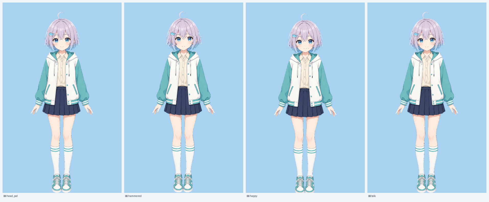
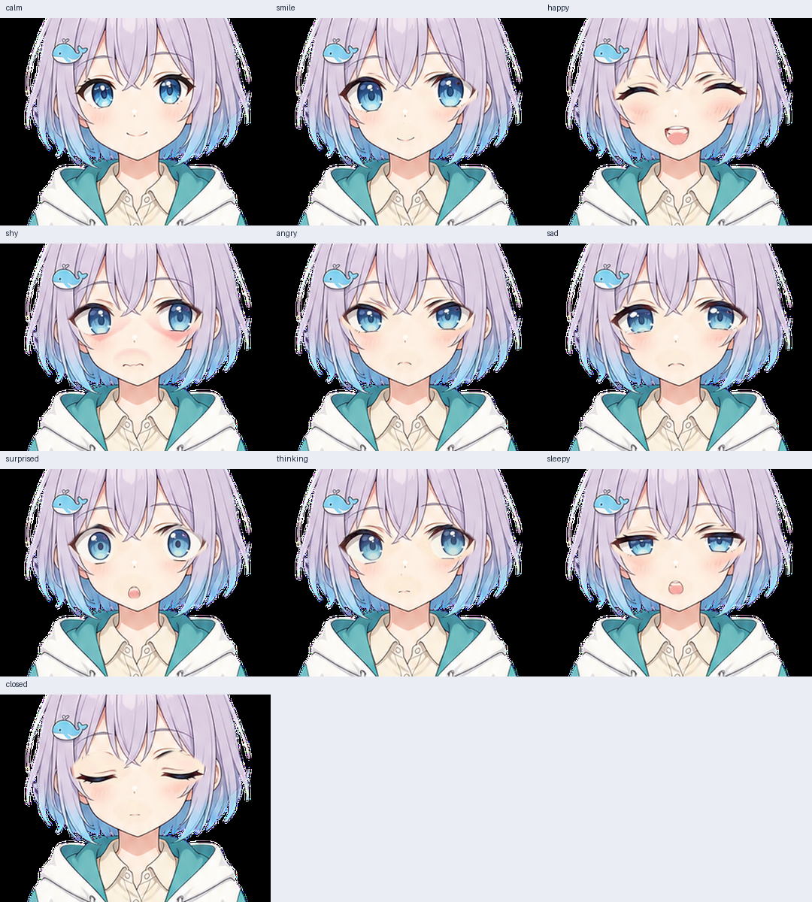

# 当前交接：小寻 teen 底层与云端预览

更新：2026-10-25。当前分支 `arena/cc642f66-zhuochong`（`pr_open`）。

## 交接优先级与保护规则

- 当前远端分支基线是提交 `d0f5958`（`Complete teen expression parts, blink and brow QA`）。此前本地检视使用的是过期的 `3b5d17b` 文件树，不能据此否定或覆盖远端已完成的层。
- **已提交的 teen 底层、rig、闭眼件和表情候选是当前保护基线。不要用本地旧版文件、失败实验或 AI 生成陌生脸覆盖它们。** `body_full.png` 原画也不得擅自覆盖。
- 远端 QA 记录显示：T2.1.1 九种表情眼件、T2.1.2 眨眼过渡、T2.1.4 眉部均已完成相应实现/测试；详见 `docs/qa/T2.1.1-expression-parts-a.md`、`docs/qa/T2.1.2-blink-transition-review.md`、`docs/qa/T2.1.4-brow-review.md`。这些是仓库记录的实现与 QA 状态，不替用户作最终审美决定。
- 当前工作区有许多相对远端基线的既有未提交差异（包括图像、代码、文档）。同步基线时仅移动了分支指针/索引并补回缺失的远端文件，没有用远端版本覆盖已有工作区文件。**不得批量 reset、clean、覆盖或一并提交这些差异；提交前必须审查暂存区。**
- 本会话在过期本地树上产生的实验图都失败，不得回写到远端底层。实验尝试包括整脸 remap、眼窝填色、inpaint/seamlessClone，以及生成式改图；AI 编辑改变了角色设计/画风，不是小寻。失败实验的记录见 `docs/HANDOVER.md` 当前交接段及本地 `/tmp`（若仍存在）。

## 云端沙箱制作与预览复现方法

下个代理可以在项目内复现运行时预览，不需要猜测或索取素材：

1. 在仓库根目录运行 `make preview`。Makefile 会构建 `build/zhuochong_preview`，并以 `--bind 0.0.0.0 --port 5173` 启动真实 C 引擎预览服务。
2. 在 Arena Agent Mode 中用后台进程启动（名称可用 `Live Preview`，命令 `make preview`，工作目录仓库根）；在 Arena 的 Live Preview 面板打开，不要把浏览器代码指向 localhost。
3. 自动回归可运行 `make -s test`、`make -s smoke`、`make -s selfcheck`；它们检查功能，不替代眼睛验收。该任务具体的运行时、blink 步进与逐表情 QA 结果见 `docs/qa/T2.1.1-expression-parts-a.md`、`docs/qa/T2.1.2-blink-transition-review.md`、`docs/qa/T2.1.4-brow-review.md`。
4. 仓库内的两张 PNG 是交接用的静态快照；`docs/images/states_preview.png` 展示全身动作，`expression_parts_a/preview_contact_sheet.png` 展示完整表情。静态图不会由启动 `make preview` 自动重写。
5. 若要单独重建表情拆件诊断预览，必须写到隔离 `/tmp` 目录，不能覆盖正式部件：

   ```bash
   python3 tools/make_face_parts.py \
     --character xiaoxun --form teen \
     --src characters/xiaoxun/parts_src/expressions_a \
     --include characters/xiaoxun/parts_src/expressions/smile.png \
     --base characters/xiaoxun/forms/teen/sprites/body_full.png \
     --rig characters/xiaoxun/forms/teen/rig.json \
     --out /tmp/xiaoxun_face_parts \
     --check-dir /tmp/xiaoxun_face_check \
     --report /tmp/xiaoxun_face_parts_report.json
   ```

   脚本会在 `/tmp/xiaoxun_face_parts/preview_contact_sheet.png` 输出静态叠图。QA 记录指出不同图像依赖版本的重跑有 27/30 张与入库 PNG 不逐字节一致；该命令只供检查，不要将重生成图回写正式目录或声称与 Live Preview 完全相同。

6. **实际全闭眼件制作方法：** 流程代码在 `tools/make_eye_closed_parts.py`，AI 重绘参考为 `characters/xiaoxun/design/redraw/face_eyesclosed.png`。脚本先以脸部肤色框定初始比例，再用排除眼区的 NCC 网格配准；随后根据 `eye_parts.json` 的眼球框裁取补片、只对皮肤像素做色差平移、用睫毛覆盖率闸检查，并输出 `eye_l_closed.png`、`eye_r_closed.png`、`eye_closed_parts.json`。这属于本项目自研 C sprite rig 的 PNG 分层流程，不是 Cubism 模型。

   ```bash
   # 必须在临时副本运行：只解出当前已提交文件，绝不写入正式工作树
   mkdir -p /tmp/zhuochong-eye-closed-check
   git -C /home/user/zhuochong archive HEAD | tar -x -C /tmp/zhuochong-eye-closed-check
   cd /tmp/zhuochong-eye-closed-check
   ~/.imgenv/bin/python tools/make_eye_closed_parts.py --character xiaoxun --form teen
   # 笑眼诊断可另在副本运行：--variant smile
   ```

   这条命令复现的是闭眼部件制作/配准；要看动态眨眼请启动前述 `make preview`。现有分支已保存并 QA 的图层是保护基线，不因“可重跑”就覆盖。

## 云端沙箱完整预览（随交接保留）

下列预览文件已存在于当前分支远端历史；请直接打开原图查看，不要用缩略图代替视觉验收：

### 全身动作状态预览

文件：[`docs/images/states_preview.png`](images/states_preview.png)。展示 `head_pat`、`hammered`、`happy`、`talk` 四种全身状态。



### 完整表情部件预览

文件：[`characters/xiaoxun/forms/teen/sprites/expression_parts_a/preview_contact_sheet.png`](../characters/xiaoxun/forms/teen/sprites/expression_parts_a/preview_contact_sheet.png)。展示 calm、smile、happy、shy、angry、sad、surprised、thinking、sleepy、closed。预览由当前 rig 底图合成，闭眼状态包含在内。



### 视觉与实现验收边界

- 表情 contact sheet 是已提交表情件/rig 的总览；动态 blink 步进和逐表情运行时 QA 的证据与数字见上述 `docs/qa/` 记录。部分高分辨率逐帧 QA 图位于临时 `build/restore-check/`，可能不在 Git 中。
- 预览可供下一位代理快速恢复项目上下文；不要把自动测试通过等同于用户最终视觉批准。
- 当前分支中已有的完整闭眼件、表情候选、眉件和 rig 动作必须先逐项核对后再改；不得重做一个局部实验就覆盖整套底层。

## 本会话最后一次错误判断的更正

此前我基于过期本地树检查了旧 `eye_open_*` / `eye_closed_*` 文件，并把“旧层不合格”的结论错误地套用到当前分支；远端最新提交已经包含更新后的 teen rig、九态眼件、真实全闭/笑眼候选、眨眼过渡修复及眉 QA。随后生成式编辑也改变了小寻设计，已否决。**这些尝试没有修改已提交的远端底层；当前任务应以 `d0f5958` 及其完整预览为准。**

## 下一步

1. 先查看上方两张完整预览及三份 QA 记录，确认当前已做好的层，不要再从旧 checkout 推断底层缺失。
2. 保护工作区所有未提交差异；若继续优化，只能在新隔离副本里操作，并以本分支当前层作为参考。
3. 只有发现明确、可复现的视觉问题时才制作针对性修正；必须在原尺寸及放大图目视检查，未通过则不接入、不覆盖。
4. 提交时仅暂存经确认的目标文件；不得把当前工作区其他差异混入交接提交。
